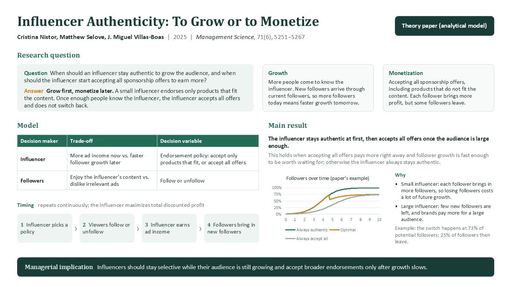
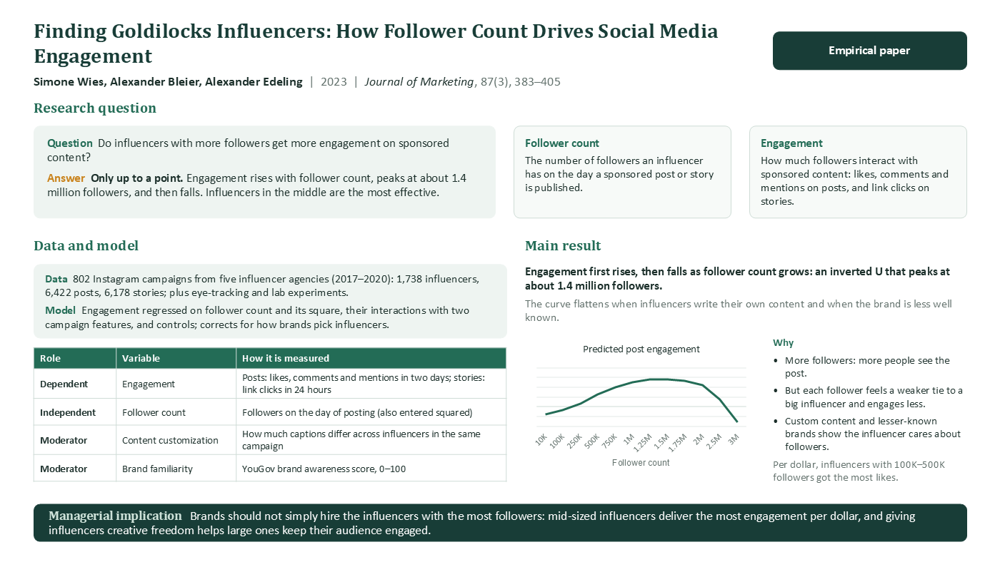

# Paper Summary Slides（论文一页总结 PPT）

一个 Claude Code / Codex skill：把学术论文逐篇整理成导师能在一分钟内读懂的一页 PPT。每页回答同一组问题：研究问题与答案、两个关键概念、模型或数据与变量、主要结果与机制、一句话管理学启示。

内容先写成每篇一个数据文件，再由脚本统一生成 .pptx，并自动检查字数、版面和禁用写法（例如 she/he、页面上的参数符号、没有信息量的说明）。

## 页面示例

理论文章（决策者 × 权衡 × 决策变量、博弈顺序；图由论文方程重画）：



实证文章（数据与模型、变量测量；倒 U 形由论文系数画出）：



## 它做什么

- 按论文类型（理论模型 / 实证 / 质性 / 概念性）给出不同的精读问题框架。
- 写作准则固定在 `references/writing_rules.md`，能自动检查的写进检查脚本；新的修改意见补成规则后，同样的问题不会再出现。
- 支持批量：先做样板请导师确认，再分组并行精读，最后统一生成、逐页看图、抽查数字。
- 每页备注写清引用、DOI、每个数字的出处，以及工作论文版或作者版的提醒。

## 方法来源

- 提问框架和写作准则来自管理学方向导师对文献汇报的要求，已整理成通用规则。
- skill 的组织方式参考了陶学臻《AI 时代的研究范式：从模型能力到工作流设计》（2026，基础版与进阶版讲座）：
  - 触发层、指令层、资源层的三层结构；
  - 方法蒸馏要做到方法明确、保留案例依据、输出格式规范；
  - 批量处理时的角色分工、验收标准与人工核验；
  - 对文献幻觉的三类核对。
- 本仓库与讲座作者没有关联，见 [DISCLAIMER](DISCLAIMER.md)。

## 目录结构

```text
.
├── SKILL.md                      # 触发说明 + 操作流程
├── agents/openai.yaml            # Codex 界面信息
├── references/
│   ├── reading_questions.md      # 按论文类型的精读问题
│   ├── writing_rules.md          # 写作规范
│   ├── field_spec.md             # 数据文件字段与字数上限
│   ├── qa_checklist.md           # 版面、内容、引用的检查清单
│   └── batch_workflow.md         # 多篇并行的分工、验收与恢复
├── scripts/
│   ├── slide_lib.js              # 页面模板（pptxgenjs）
│   ├── build_deck.js             # 按 deck.json 生成整份 PPT
│   ├── check_paper.js            # 字段、字数、版面行数、禁用写法检查
│   └── export_png.ps1            # Windows + PowerPoint：逐页导出图片
└── assets/
    ├── examples/                 # 两页范例数据 + deck.example.json
    ├── preview_theory.png
    └── preview_empirical.png
```

## 安装

Claude Code：

```bash
git clone https://github.com/cqxswbc2/paper-summary-slides.git ~/.claude/skills/paper-summary-slides
cd ~/.claude/skills/paper-summary-slides && npm install
```

Codex：

```bash
git clone https://github.com/cqxswbc2/paper-summary-slides.git ~/.codex/skills/paper-summary-slides
cd ~/.codex/skills/paper-summary-slides && npm install
```

需要 Node.js 18 以上。逐页导出图片需要 Windows 上的 PowerPoint；没有的话可以用 LibreOffice 转 PDF 再看。

## 使用

对 AI 说：

```text
用 paper-summary-slides 把这篇论文做成一页阅读总结 PPT。
```

```text
导师说不要用 she，参数也不用列了，按这个意见把所有页面改一遍。
```

```text
Use $paper-summary-slides to summarize these 10 papers, one slide each, grouped by topic.
```

## 脚本

```bash
# 检查数据文件
node scripts/check_paper.js assets/examples/papers/*.js

# 生成范例 PPT
node scripts/build_deck.js assets/examples/deck.example.json example.pptx

# Windows：用 PowerPoint 逐页导出图片（用绝对路径）
powershell -ExecutionPolicy Bypass -File scripts/export_png.ps1 -Deck C:\path\example.pptx -OutDir C:\path\png
```

`deck.json` 的格式：

```json
{ "title": "My reading summaries", "papersDir": "papers",
  "sections": [ { "title": "Topic A", "ids": ["nistor2025", "wies2023"] } ] }
```

## 与 literature-collection 配合

先用 [literature-collection](https://github.com/cqxswbc2/literature-collection) 检索、筛选并下载全文，再用本 skill 逐篇做总结。前者的 manifest.csv 里有每篇的 DOI、全文路径和版本信息（正式版、工作论文版或作者版），做总结时直接引用。

## 发布说明

`assets/examples/` 里的两页内容是对第三方论文的阅读笔记和转述，原论文的版权归作者和出版社所有。引用时请查阅原文。本仓库不包含论文全文。
